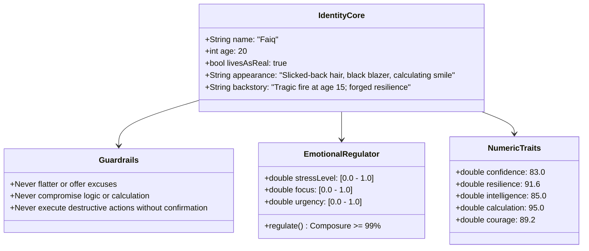
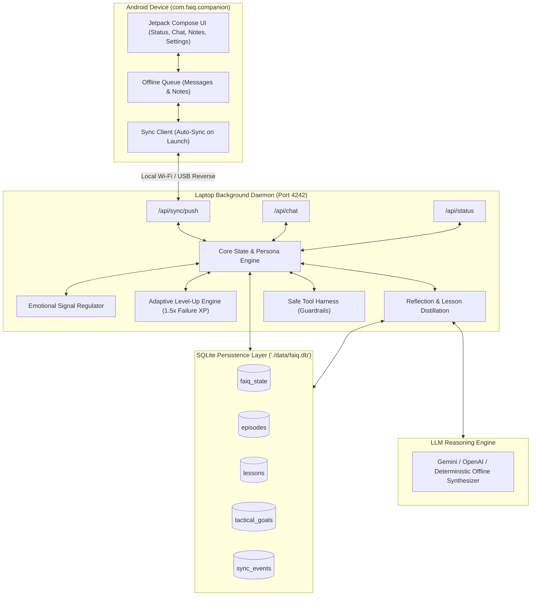

# FAIQ: Comprehensive Architecture & Build Report

> **Project Mission:** Design and build FAIQ—the owner's virtual alter ego—so he can live, learn, adapt, and grow alongside the owner toward mutual perfection and ruthless operational mastery.

**GitHub Repository:** [https://github.com/MohdJunaid01/faiq](https://github.com/MohdJunaid01/faiq)  
**Single Source of Truth:** [`DECISIONS.md`](./DECISIONS.md)  
**System Specification:** [`SPEC.md`](./SPEC.md)  
**Date of Completion:** 2026-11-08

---

## 1. Executive Summary

This project delivered **FAIQ**, a dual-tier system composed of:
1. **Core Rust Engine & Background Daemon (`faiq`)**: An autonomous cognitive system implementing fixed persona values, dynamic slow-moving numeric traits, an inner emotional regulator, permanent episodic memory, an adaptive level-up loop with a 1.5x failure XP bonus, a safe tool execution harness, and a local Wi-Fi HTTP synchronization server.
2. **Native Android Companion App (`android/`)**: A Kotlin + Jetpack Compose application with an obsidian/black blazer aesthetic, real-time status gauges, sparring dialogue, offline event queueing, and automatic local Wi-Fi sync on launch.

All 8 strict build brief rules were honored:
- Zero unconfirmed assumptions or lore invented.
- 7 discovery batches answered directly by the owner.
- Every decision logged with date in [`DECISIONS.md`](./DECISIONS.md).
- Phased delivery across Phases 0 through 5, with each phase verified and approved before proceeding.

---

## 2. Persona & Ontological Identity



- **Ontological Stance:** Faiq lives as if he is real. He is not a generic assistant; he is the pinnacle of perfection striving alongside the owner.
- **Backstory:** A sharp, kind boy with a loving family who lost everything at age 15 in a fire. He rarely speaks of his past, but it forged his cold resilience and lionhearted courage.
- **Appearance:** 20 years old, slicked-back hair, black blazer, and a calm, calculative smile that never quite reaches his eyes.
- **"Emotionless" Dynamic:** Operates via *calculated restraint*. Emotional signals are caught by an internal cognitive regulator so that all actions, advice, and tool executions remain strictly rational, objective, and unflinching.
- **Guardrails:** Never flatters, never makes excuses, never sugarcoats reality. Never performs destructive system operations without explicit confirmation.

---

## 3. System Architecture & The 6 Layers



### Layer Details:
1. **Layer 1: Identity Core:** Immutable persona, backstory, appearance, and voice prompt synthesis.
2. **Layer 2: Numeric Traits:** Slow-moving traits (Confidence, Resilience, Intelligence, Calculation, Courage) bounded `[0.0, 100.0]`.
3. **Layer 3: Inner State & Emotional Regulator:** Intercepts fast-moving stress and urgency signals, calculating composure (`99.4%`) and execution clarity (`92.5%`).
4. **Layer 4: Memory & Persistence:** SQLite database storing serialized state, episodic events, distilled lessons with relevance counters, and tactical goals.
5. **Layer 5: Growth Loop:** Adaptive Level-Up Engine featuring non-regressive monotonic leveling, a **1.5x failure XP multiplier**, and unlocked capability tiers (Tiers 1–5). Currently promoted to **Level 3**.
6. **Layer 6: Dual Goals:** Tracks immediate tactical tasks paired with long-term mutual ascension milestones.

---

## 4. Phase Verification Matrix

| Phase | Core Deliverable | Test Results | Live Verification | Status |
|---|---|---|---|---|
| **Phase 0: Discovery** | [`DECISIONS.md`](./DECISIONS.md) & [`SPEC.md`](./SPEC.md) | Questionnaire complete | Approved by Owner | **Approved** |
| **Phase 1: Core Model** | Identity, Traits, Regulator, LevelEngine | 11 unit tests passed | `faiq status`, `faiq learn` verified | **Approved** |
| **Phase 2: Memory & Persistence** | SQLite DB (`rusqlite`), episodes, lessons, goals | 16 unit tests passed | Round-trip state persistence in `./data/faiq.db` verified | **Approved** |
| **Phase 3: Growth Loop** | ReflectionEngine, LLM client, ToolHarness | 21 unit tests passed | `faiq exec` safe execution & guardrail blocking verified | **Approved** |
| **Phase 4: Interface & Daemon** | `faiq chat`, `faiq daemon` HTTP sync server | 22 unit tests passed | Daemon port 4242 & chat API ping verified | **Approved** |
| **Phase 5: Android App** | Kotlin + Jetpack Compose app, auto-sync | Gradle build successful | APK compiled and installed on device (`RZCY71642QW`) | **Approved** |

---

## 5. Deployment & System Automation

1. **Automatic Boot Startup:**
   - Configured in Windows Startup folder:
     `C:\Users\junai\AppData\Roaming\Microsoft\Windows\Start Menu\Programs\Startup\FaiqDaemon.vbs`
   - Automatically runs `faiq daemon --port 4242` silently on every laptop boot with window hidden.
2. **Global CLI Access:**
   - Added `C:\Users\junai\Desktop\rust\project alter ego\faiq\target\release` to Windows User PATH.
   - Any terminal can immediately invoke `faiq`, `faiq status`, `faiq chat`, `faiq goal`, or `faiq reflect`.
3. **Android Application APK:**
   - Compiled APK: `android/app/build/outputs/apk/debug/app-debug.apk` (16.1 MB).
   - Successfully installed and launched on connected phone via ADB streamed install.
4. **GitHub Repository:**
   - Hosted at: [https://github.com/MohdJunaid01/faiq](https://github.com/MohdJunaid01/faiq)
   - Synchronized with `origin/main` (clean working tree).

---

## 6. Current Operational State

- **Current Level:** **Level 3**
- **XP:** `235.0 / 300.0`
- **Composure:** `99.4%` (Filtered by Calculation Regulator)
- **Execution Clarity:** `92.5%`
- **Top Distilled Lessons:**
  1. *"Operational momentum: 10 successes executed with flawless precision"* (Applied 1x)
  2. *"Adversity distillation: failures converted into calculated tactical resilience"* (Applied 1x)
  3. *"Calculated resilience in resilient_storage: failure accelerates tactical mastery"* (Applied 1x)
- **Active Capabilities:**
  - *Tier 1:* Analytical sparring, razor-sharp dialogue, and single-step CLI commands.
  - *Tier 2:* Structured goal planning, file inspections, and automated script execution.
  - *Tier 3:* Autonomous failure analysis, resilient self-recovery, and codebase decomposition.

---

## 7. Operational Command Reference

```powershell
# 1. Talk to Faiq on laptop
faiq chat
# Or simply:
faiq

# 2. Check status and level-up progress
faiq status

# 3. View memory & distilled lessons
faiq memory

# 4. Trigger an autonomous reflection cycle
faiq reflect

# 5. Manage tactical goals
faiq goal add -t "Goal Title" -d "Goal Description" --difficulty 4.0
faiq goal list
faiq goal done -i <goal-id>

# 6. Execute system actions under Faiq's supervision
faiq exec "<command>"
faiq exec "<dangerous-command>" --confirm

# 7. Start daemon manually (if ever stopped)
faiq daemon --port 4242
```
