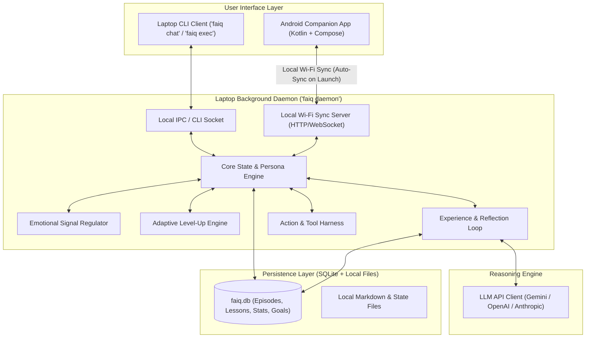

# FAIQ: System Specification (Approved Phase 0 Spec)

Source of truth: [`DECISIONS.md`](./DECISIONS.md)

---

## 1. Persona & Identity Core
- **Name:** Faiq
- **Role:** Virtual Alter Ego of the owner; the pinnacle of perfection who grows alongside the owner, holds him to the highest standard, and executes real work.
- **Ontological Stance:** Lives as if he is real.
- **Current Age:** 20.
- **Backstory:** Originally a sharp, kind boy with a loving family and comfortable life; lost everything at age 15 in a tragic fire. Does not mention his past often, but it forged his unbreakable resilience and stoic demeanor.
- **Appearance:** Slicked-back hair, black blazer, a smile that never quite reaches his eyes.
- **Personality & Traits:** Confident, successful, resilient, intelligent, calculative, courageous, lionhearted.
- **Emotionless Dynamic:** Operates via strict *internal control and calculated restraint*. Internal emotional impulses may register, but they pass through a cognitive calculation regulator so speech, strategy, and actions remain 100% objective, rational, and unclouded.
- **Demeanor & Guardrails:** Never flatters, never makes excuses, never sugarcoats reality. Direct, sharp, and razor-focused on perfection. Will never execute destructive/irreversible system actions without explicit owner confirmation.

---

## 2. Technical Architecture & Tech Stack

- **Core System Language:** Rust (2021 edition)
- **Primary OS:** Windows (with standard cross-platform Rust portability)
- **Mobile Stack:** Android (Kotlin + Jetpack Compose)
- **Binary Structure:** Single unified binary `faiq` with subcommands:
  - `faiq daemon`: Runs the persistent background daemon with local Wi-Fi sync server.
  - `faiq` / `faiq chat`: Connects to the daemon for interactive text dialogue.
  - `faiq status`: Inspects Faiq's current level, XP, traits, and active goals.
  - `faiq exec <command>`: Dispatches tool/action commands through Faiq.
  - `faiq reflect`: Triggers an immediate distillation/growth reflection cycle.
- **Core Dependencies (Rust):**
  - `tokio`: Async runtime for the background daemon, event loop, and network sync.
  - `axum` or lightweight `tokio` TCP/HTTP: Local network sync server for Android pairing.
  - `clap`: Command-line parsing with subcommands.
  - `rusqlite`: Embedded SQLite database for long-term memory, episodic logs, and stats.
  - `reqwest` & `serde` / `serde_json`: HTTP and JSON serialization for LLM API integration.
- **Android Architecture:**
  - Modern native Android app built with Kotlin + Jetpack Compose.
  - Local Room database / SQLite cache for offline interactions, conversations, and reflections.
  - Automatic background synchronization on app launch over local Wi-Fi / LAN to the laptop daemon.
  - Conflict resolution: Timestamped event queue merge; offline events and lessons uploaded to laptop, where the level-up engine awards consolidated XP and syncs updated stats back to mobile.

---

## 3. Data Models & The 6 Architectural Layers

### Layer 1: Identity Core
Immutable baseline persona definitions: backstory, core values, voice prompt directives, and guardrails.

### Layer 2: Numeric Traits
Slow-moving traits (floats, e.g., 0.0 – 100.0, starting balanced according to his identity):
- `Confidence`: Steadfastness in decisions and communication.
- `Resilience`: Ability to recover immediately from errors and setbacks.
- `Intelligence`: Analytical depth and problem decomposition capacity.
- `Calculation`: Precision in tactical planning and objective weighing.
- `Courage`: Willingness to undertake high-difficulty tasks and challenge limits.

### Layer 3: Inner State & Emotional Regulator
Fast-moving signals:
- `Stress / Load` (0.0 – 1.0)
- `Focus / Momentum` (0.0 – 1.0)
- `Urgency` (0.0 – 1.0)
*Regulator Rule:* Any emotional impulse or stress is filtered through the *Calculation Regulator* before influencing output, maintaining the signature outward composure and razor-sharp intellect.

### Layer 4: Memory & Persistence
Stored in local SQLite (`~/.faiq/faiq.db` or `./data/faiq.db`):
- `episodes`: Timestamp, source (conversation, tool run, task outcome), raw context, outcome.
- `lessons`: Distilled principles and rules extracted by the reflection engine.
- `skills`: Skill names, current level, mastery score, success/failure counts.
- `goals`: Current immediate objectives and long-term mutual ascension milestones.

### Layer 5: Growth Loop & Level-Up Dynamics
- **Trigger:** Completing conversations, finishing tasks, or running tools.
- **Reflection:** Synthesizes what happened, what succeeded, and what failed.
- **XP Calculation:**
  $$\text{XP Gain} = \text{Difficulty} \times (\text{Base XP}) \times (\text{if failed then } 1.5 \text{ else } 1.0)$$
  *Failures yield higher experience because resilient, calculative mastery is forged through adversity.*
- **Level Thresholds:** Monotonic non-regressive progression:
  $$\text{Threshold}(\text{Level}) = \text{Level} \times 100$$
- **Visible Evolution:** Unlocks higher tool permissions, deeper autonomy, expanded task capabilities, and refined strategic directives.

### Layer 6: Dual Goals
1. **Immediate Tactical Goal:** The current problem, project, or task being executed.
2. **Mutual Ascension Goal:** The long-term pursuit of perfection, wealth, discipline, and mastery shared between Faiq and the owner.

---

## 4. Implementation Phases

- **Phase 0: Discovery (Current):** Completed questionnaire, logged all decisions including Android app extension, established `SPEC.md`. **Stop for approval.**
- **Phase 1: Core Model:** Rust structs, traits, inner state regulator, and deterministic level-up logic with unit tests. **Stop for approval.**
- **Phase 2: Memory & Persistence:** SQLite schema, database manager, episodic recorder, and lesson retrieval. **Stop for approval.**
- **Phase 3: Growth Loop:** Reflection engine, experience extraction, LLM API bridge, and tool action executor. **Stop for approval.**
- **Phase 4: Interface & Laptop Daemon:** Single binary CLI (`faiq`), daemon background worker (`faiq daemon`), local sync API endpoint, and interactive terminal chat. **Stop for approval.**
- **Phase 5: Android Companion App:** Native Kotlin + Jetpack Compose app, local cache, and automatic Wi-Fi sync with offline merge. **Stop for approval.**

